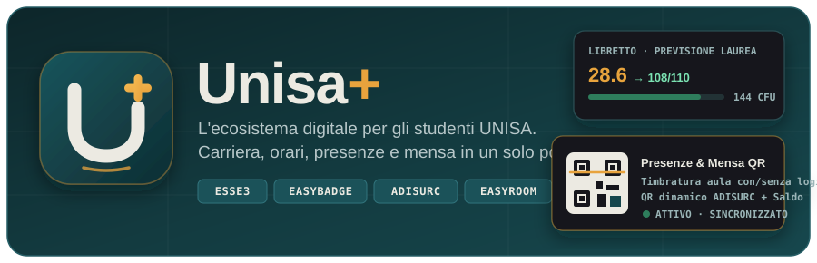

<p align="center">
  
</p>

<p align="center">
  <a href="https://github.com/emmesaux/UnisaPlus/releases/latest"><b>Scarica APK (Android)</b></a>
  ·
  <a href="#funzionalit%C3%A0">Funzionalità</a>
  ·
  <a href="#servizi-integrati">Servizi integrati</a>
  ·
  <a href="#avvio-rapido">Avvio rapido</a>
  ·
  <a href="#build-automatiche-github-actions">Build CI / CD (Android &amp; iOS)</a>
  ·
  <a href="#licenza-e-copyright">Licenza</a>
</p>

# Unisa Plus

Applicazione mobile pensata per gli studenti dell'**Università degli Studi di Salerno (UNISA)**: raccoglie in un'unica interfaccia rapida, coerente e priva di fronzoli tutto ciò che nella quotidianità del campus è diviso tra tre o quattro portali e applicazioni differenti.

Orario delle lezioni, rilevazione e consultazione delle presenze in aula (**EasyBadge**), libretto universitario con simulatore del voto di laurea, appelli d'esame, bacheca esiti, situazione tasse (**Esse3**), aule libere in tempo reale con timeline giornaliera (**EasyRoom**), avvisi ufficiali di Ateneo e Dipartimento e tesserino mensa con saldo, QR dinamico e menù del giorno (**ADISURC**).

Nessun server intermedio, nessun tracciamento: l'app dialoga direttamente dal tuo telefono con gli endpoint ufficiali di Ateneo, CINECA e ADISURC.

> **Disclaimer:** *Unisa Plus* è un progetto indipendente sviluppato per gli studenti e **non** è affiliato ufficialmente con l'Università degli Studi di Salerno (UNISA), il consorzio CINECA, EasyStaff o ADISURC Campania.

## Funzionalità

- **Orario delle lezioni ed esportazione calendario** — Calendario settimanale e giornaliero dei corsi (`AgendaStudenti / EasyCourse`) con filtri per insegnamento, orari, docenti, codici aula e aggiunta rapida delle lezioni al calendario di sistema.
- **Presenze in aula (con e senza accesso)** — Scansione del codice QR proiettato dal docente in aula (con decodifica automatica del payload Base64 EasyBadge) o inserimento manuale del codice lezione tramite `TimbratureApi.php`, più consultazione della percentuale di frequenza, delle ore svolte/frequentate e dello storico timbrature lezione per lezione.
- **Libretto universitario e previsione di laurea** — Riepilogo di media aritmetica, media ponderata, base di laurea su 110, CFU maturati su totali, distribuzione dei voti, andamento cronologico e **simulatore interattivo**: aggiungi esami ipotetici (voto e CFU) e regola i punti di tesi/bonus per vedere in tempo reale come cambiano media e voto finale stimato.
- **Appelli d'esame e Bacheca esiti** — Consultazione degli appelli disponibili, delle prenotazioni attive (con ricevuta e posto) e della bacheca esiti con lo stato di verbalizzazione o pubblicazione del voto.
- **Situazione Tasse (Esse3)** — Controllo immediato delle fatture e dei contributi universitari (pagati, in scadenza o scaduti) con importi, IUV/bollettino, causale e semaforo di stato.
- **Mensa ADISURC (Saldo e QR dinamico)** — Accesso SPID/CIE al servizio ristorazione ADISURC con lettura automatica del saldo borsellino, codice utente e generazione del **QR code dinamico** (aggiornato automaticamente ogni 2 secondi) valido ai tornelli della mensa, senza bisogno di scansionare un secondo dispositivo per associare il borsellino.
- **Aule libere in tempo reale** — Mappa dello stato di occupazione di tutte le aule del campus (per edificio e fascia oraria) basata sui dati live di `EasyRoom`.
- **Avvisi di Ateneo e Dipartimento** — Doppia bacheca aggiornata in tempo reale con i comunicati ufficiali dell'Ateneo (`web.unisa.it`) e la bacheca didattica del proprio Dipartimento.
- **Supporto multi-carriera** — Se hai più matricole o carriere attive (es. triennale conclusa e magistrale in corso), puoi passare da una carriera all'altra in qualsiasi momento.

## Con e senza accesso

Non tutto richiede il login universitario. Anche dalla schermata iniziale, **senza effettuare l'accesso**, puoi usare subito:

| Funzione senza login | Cosa permette di fare |
|---|---|
| **Rileva e consulta presenze** | Timbra la presenza in aula inserendo una o più matricole e inquadrando il QR del docente (ricorda automaticamente l'ultima matricola usata) e consulta il riepilogo frequenza corso per corso |
| **Aule libere** | Verifica quali aule di ciascun edificio sono libere adesso o per il resto della giornata |
| **Orario corsi** | Scegli corso di laurea, anno e partizione per consultare l'orario completo delle lezioni |

## Servizi integrati

L'applicazione comunica esclusivamente in HTTPS con i servizi ufficiali già utilizzati dagli studenti UNISA:

| Ambito | Servizio / Endpoint | Autenticazione |
|---|---|---|
| **Carriera, Libretto, Esami, Esiti, Tasse** | `esse3web.unisa.it` (`e3rest/api/...`) | OIDC / Basic CINECA (Credenziali UNISA / SPID / CIE) |
| **Orario delle lezioni e Corsi** | `easycourse.unisa.it/AgendaStudenti` (`combo.php`, `grid_call.php`) | Pubblico |
| **Rilevazione e Consultazione Presenze** | `easycourse.unisa.it/EasyBadgeNew/api/` (`TimbratureApi.php`, `corso_iscritti.php`, `timbrature.php`) | Credenziale app EasyBadge + Matricola studente |
| **Occupazione Aule** | `easycourse.unisa.it/EasyRoom/do.php` | Pubblico |
| **Avvisi Ateneo e Dipartimento** | `web.unisa.it` / portali di Dipartimento (`unisa.it`) | Pubblico |
| **Mensa Universitaria** | `mensa-agw-02.dirittoallostudio.it` (ADISURC Campania) | Sessione SPID / CIE + chiave QR borsellino |

## Privacy e sicurezza

- **Nessun server di terze parti:** il codice sorgente è interamente ispezionabile in questo repository; nessuna richiesta passa per server esterni.
- **Archiviazione protetta:** i token di sessione e il segreto del QR mensa vengono custoditi localmente nel **Keychain di iOS** / **EncryptedSharedPreferences (Keystore) di Android** tramite `flutter_secure_storage`.
- **Disconnessione pulita:** il logout rimuove i token salvati sul dispositivo e pulisce i cookie della WebView di autenticazione.

## Avvio rapido

### Scaricare l'app pronta (Android)

1. Vai nella sezione [**Releases**](https://github.com/emmesaux/UnisaPlus/releases/latest) di questo repository.
2. Scarica **`UnisaPlus-v1.0.0.apk`** (universale) oppure **`UnisaPlus-v1.0.0-arm64-v8a.apk`** (leggero per smartphone moderni a 64-bit).
3. Apri il file `.apk` sul telefono per installarlo.

### Compilare da codice sorgente

Richiede **Flutter SDK** (`>= 3.10`).

```bash
# Clona il repository
git clone https://github.com/emmesaux/UnisaPlus.git
cd UnisaPlus

# Installa le dipendenze
flutter pub get

# Avvia in modalità sviluppo su un dispositivo o emulatore connesso
flutter run

# Compila l'APK di rilascio per Android
flutter build apk --release
```

## Build automatiche (GitHub Actions)

Il repository include due workflow CI/CD in `.github/workflows/`:

### 1. Android Build & GitHub Release (`.github/workflows/android-release.yml`)

- Si attiva automaticamente a ogni push di un tag `v*` (es. `git tag v1.0.0 && git push origin v1.0.0`) oppure manualmente tramite **Actions → Android Build & GitHub Release (APK) → Run workflow**.
- Compila l'APK universale e gli APK `split-per-abi` (`arm64-v8a`, `armeabi-v7a`) e li allega direttamente alla pagina **Releases** di GitHub.
- Funziona subito senza configurare segreti; se vuoi firmare con un tuo keystore di produzione, aggiungi nei *GitHub Secrets*:
  - `ANDROID_KEYSTORE_BASE64`
  - `ANDROID_KEYSTORE_PASSWORD`
  - `ANDROID_KEY_ALIAS`
  - `ANDROID_KEY_PASSWORD`

### 2. iOS Build & Release su TestFlight (`.github/workflows/ios-release.yml`)

- Avviabile manualmente da **Actions → iOS Build & Release (TestFlight) → Run workflow** (con opzione per produrre solo l'artefatto `.ipa` oppure caricarlo direttamente su **TestFlight** tramite Fastlane e App Store Connect API Key).
- Estrae automaticamente `UUID`, `Name`, `TeamIdentifier` e `Bundle ID` dal Provisioning Profile e applica la firma manuale **solo sul target `Runner`** (evitando errori di firma sui target Pods/SPM).

| Secret GitHub (iOS) | Descrizione |
|---|---|
| `CERTIFICATE_P12_BASE64` | Certificato di distribuzione Apple `.p12` codificato in Base64 |
| `CERTIFICATE_P12_PASSWORD` | Password del certificato `.p12` |
| `PROVISIONING_PROFILE_BASE64` | Profilo `.mobileprovision` App Store codificato in Base64 |
| `APP_STORE_CONNECT_API_KEY_BASE64` | File `AuthKey_XXXXXX.p8` di App Store Connect codificato in Base64 |
| `APP_STORE_CONNECT_KEY_ID` | Key ID della chiave API di App Store Connect |
| `APP_STORE_CONNECT_ISSUER_ID` | Issuer ID di App Store Connect |

## Licenza e Copyright

Copyright © 2026 **emmesaux**. Tutti i diritti riservati — consulta il file [LICENSE](LICENSE).

Il codice sorgente è reso visibile in modalità *Source-Available* esclusivamente a scopo di trasparenza per gli studenti utilizzatori. **È severamente vietata la copia, la modifica, la redistribuzione o la pubblicazione non autorizzata su store di terze parti (App Store, Google Play Store o siti esterni).**

